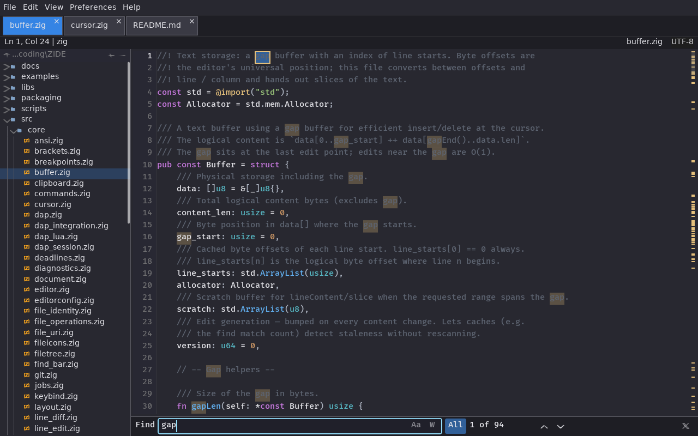
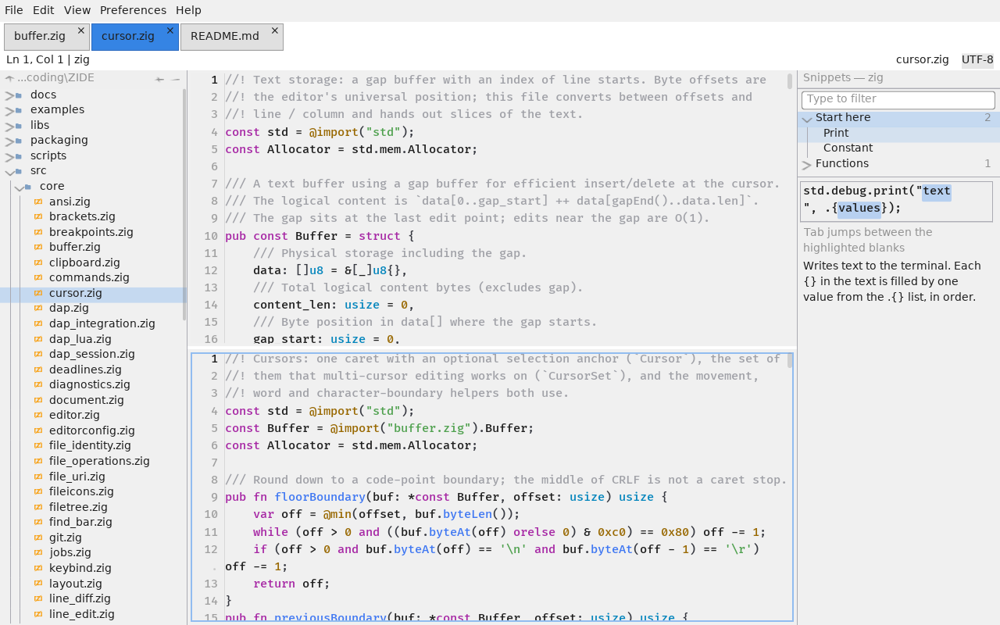

# ZIDE

**Zimplified Integrated Development Environment** — a lightweight code editor written in
[Zig](https://ziglang.org) with two faces built from one core: a desktop GUI and a terminal
TUI. Editing is familiar and non-modal (Ctrl+S saves, Ctrl+F finds). Languages, language
servers, keys, snippets and tools are added with Lua, so you grow ZIDE into the IDE you
want instead of switching off the parts you do not.



`zide` is one hybrid binary. Typed in a terminal it opens the TUI right there; started from
the desktop it opens the GUI. Both run the same commands, key map, settings and extensions.

## What it does

A summary. [docs/Documentation.md](docs/Documentation.md) describes every feature in
detail, and [docs/TODO.md](docs/TODO.md) is the working backlog.

- **Editing** — multiple cursors and block selection, undo that brings every cursor back,
  auto-closing brackets, bracket matching, comment toggling, word wrap, EditorConfig, and
  UTF-8, UTF-16 and Windows-1252 files saved back in the encoding they came in.
- **Finding things** — a find bar that stays open while you edit, workspace search and
  replace, fuzzy quick open with a live preview, a command palette, back / forward through
  your jumps.
- **Layout** — tabs, split panes and several OS windows; a file tree with file operations
  and Git status colors; a Snippets panel; an embedded terminal, as a pane or as a docked
  panel.
- **Languages** — syntax highlighting (Zig and Markdown built in, more registered from Lua)
  and a Language Server Protocol client: diagnostics, completion, go to definition,
  references, symbols, signature help, hover, rename with a preview, formatting. Several
  servers can serve one language.
- **Tools** — tasks with problem matchers and a Problems view; Git changes with diffs,
  staging and gutter marks; a review reader for going through what changed, file by file;
  a Debug Adapter Protocol client.
- **Safety** — crash-recovery snapshots, a guard against files changed on disk, atomic
  saves.
- **Lua** — `~/.config/zide/init.lua` and an extensions folder set options and keys and
  register languages, servers, commands, hooks, snippets, tasks and diagnostics.
- **Looks** — dark, light and high-contrast themes with every color overridable, and a
  software renderer for machines without usable graphics drivers.

Windows and Linux. About 72,000 lines of Zig with more than 600 tests; the GUI's tests
drive the real interface in hidden windows.



The same project in the terminal version (a screen dump, so without its colors):

```text
 buffer.zig | cursor.zig |
^ ...\development\coding\ZIDE│  1 //! Text storage: a gap buffer with an index of line starts. Byte
+ docs                       │  . offsets are
+ examples                   │  2 //! the editor's universal position; this file converts between
+ libs                       │  . offsets and
+ packaging                  │  3 //! line / column and hands out slices of the text.
+ scripts                    │  4 const std = @import("std");
- src                        │  5 const Allocator = std.mem.Allocator;
│ - core                     │  6
│ │   ansi.zig               │  7 /// A text buffer using a gap buffer for efficient insert/delete
│ │   brackets.zig           │  . at the cursor.
│ │   breakpoints.zig        │  8 /// The logical content is `data[0..gap_start] ++
│ │   buffer.zig             │  . data[gapEnd()..data.len]`.
│ │   clipboard.zig          │  9 /// The gap sits at the last edit point; edits near the gap are
│ │   commands.zig           │  . O(1).
│ │   cursor.zig             │ 10 pub const Buffer = struct {
│ │   dap.zig                │ 11     /// Physical storage including the gap.
│ │   dap_integration.zig    │ 12     data: []u8 = &[_]u8{},
│ │   dap_lua.zig            │ 13     /// Total logical content bytes (excludes gap).
│ │   dap_session.zig        │ 14     content_len: usize = 0,
│ │   deadlines.zig          │ 15     /// Byte position in data[] where the gap starts.
│ │   diagnostics.zig        │ 16     gap_start: usize = 0,
│ │   document.zig           │ 17     /// Cached byte offsets of each line start. line_starts[0] ==
│ │   editor.zig             │  . 0 always.
│ │   editorconfig.zig       │ 18     /// line_starts[n] is the logical byte offset where line n
│ │   file_identity.zig      │  . begins.
│ │   file_operations.zig    │ 19     line_starts: std.ArrayList(usize),
│ │   file_uri.zig           │ 20     allocator: Allocator,
│ │   fileicons.zig          │ Find gap                       Aa   W   All        1 of 94  ↑  ↓   ×
 buffer.zig                                                              Ln 1, Col 24 | zig | UTF-8
```

The pictures are rendered off-screen through the GUI's test harness, so they show the real
interface without a window frame.

## How it is built

ZIDE is one person's project, built together with an AI coding assistant. I decide what
the editor should do, settle each feature's design, and test the result on screen. The
code is written with Claude, Anthropic's coding assistant, which is why most commits carry
a `Co-Authored-By: Claude` line. [docs/TODO.md](docs/TODO.md) is the working record of
that collaboration: what was asked for, what was decided, and what is still open.

## Build

Needs Zig 0.16.0. One command builds both frontends; the first build downloads the pinned
dependencies.

```
zig build
./zig-out/bin/zide-tui         # the TUI, in this terminal
./zig-out/bin/zide             # the GUI
```

`zide` is the hybrid binary: typed in a terminal it opens the TUI there,
launched from the desktop it opens the GUI. `zide-tui` is TUI-only.
Add `-Doptimize=ReleaseSafe` for a release build.

Debug builds keep ZIDE's Zig code debuggable and compile SDL's CPU pixel loops
with optimizations. Use `-Dsdl-optimize=Debug` when debugging SDL itself.

`zig build test` runs the core tests and `zig build test-gui` the GUI's.
Run `./scripts/check.ps1` on Windows or `bash scripts/check.sh` on Linux to
build both frontends and run both suites in Debug and ReleaseSafe. Set
`ZIG` to select a Zig 0.16.0 executable. Prerequisites and logs are described
in [the validation guide](tests/VALIDATION.md).

## Opening a project

```
zide .                      # this folder is the project
zide ~/code/app             # that folder
zide . src/main.zig         # project plus a file
```

The folder becomes the file tree root and the workspace every language
server sees. Without a folder argument the project is wherever you launched
ZIDE from — starting it from `zig-out/bin` makes that the project, which is
rarely what you want.

## Install on Windows (manual)

There is no installer yet; installing is a build into a folder on your PATH
plus one shortcut.

1. Build straight into a personal bin folder (PowerShell):

   ```
   zig build -Doptimize=ReleaseSafe -p "$env:USERPROFILE\.local"
   ```

   That creates `%USERPROFILE%\.local\bin\zide.exe` and `zide-tui.exe`.
   Re-run the same command after updating the sources.

2. Put that folder on your PATH once: Start menu → "Edit environment
   variables for your account" → `Path` → New → `%USERPROFILE%\.local\bin`.
   New terminals can then run `zide` (TUI) or `zide .` from anywhere.

3. For the Start menu / desktop: right-click `zide.exe` → Create shortcut,
   move it into `%APPDATA%\Microsoft\Windows\Start Menu\Programs`. Set the
   shortcut's "Start in" field to your project folder, or put the folder on
   the Target line (`zide.exe C:\code\app`). Launched this way it opens the GUI.

4. Uninstall = delete the folder, remove the PATH entry, delete the shortcut.
   Your settings live separately in `%USERPROFILE%\.config\zide`.

What a proper installer (Inno Setup script or a Scoop manifest) would add on
top, for later: an `App Paths` registry key so Start/Run find `zide` without
PATH, a `.zig` file association and "Open with ZIDE" on folders (ProgID keys
under `HKCU\Software\Classes` plus a Default Apps registration), and an entry
under `...\CurrentVersion\Uninstall` so it shows in Add or Remove Programs.

## Install on Linux

**Plain copy** (the same idea as Windows):

```
zig build -Doptimize=ReleaseSafe
cp zig-out/bin/zide zig-out/bin/zide-tui ~/.local/bin/
cp packaging/zide.desktop ~/.local/share/applications/
mkdir -p ~/.local/share/icons/hicolor/scalable/apps
cp src/icons/zide-red.svg ~/.local/share/icons/hicolor/scalable/apps/zide.svg
```

`~/.local/bin` is on PATH on most distros once the folder exists (log out and
in again the first time). `zide` in a terminal opens the TUI; the app menu
entry opens the GUI.

**AppImage** (single file, no install):

1. Get `appimagetool` (a single-file download from the appimagetool GitHub
   releases), `chmod +x` it and drop it in `~/.local/bin`.
2. From the repo: `./packaging/make-appimage.sh`. It builds ReleaseSafe,
   assembles the AppDir with both binaries, the icon and the desktop entry,
   and writes `zig-out/ZIDE-x86_64.AppImage`.
3. Move the AppImage anywhere, `chmod +x` it, run it. For terminal use,
   symlink it: `ln -s /path/to/ZIDE-x86_64.AppImage ~/.local/bin/zide`.

SDL3, freetype and Lua are linked statically. SDL loads desktop libraries at
runtime; native Wayland presentation also requires working graphics-driver
libraries (for example EGL/OpenGL ES). X11 software rendering can run without
those graphics APIs.

## Configuration

`~/.config/zide/init.lua` holds settings, key bindings and language servers;
`~/.config/zide/extensions/*.lua` holds languages, commands and hooks. ZIDE
creates commented example extensions there on first launch, including
`example-lsp-servers.lua` with ready-to-uncomment server registrations.

### Renderer

The first GUI launch asks for Automatic, Hardware accelerated, or Software
rendering. Change this later in Settings; the new preference takes effect
after restarting ZIDE. Existing and newly opened windows keep the active
renderer until that restart. The choice is saved in `~/.config/zide/renderer.json`.

For a single launch, including recovery from a renderer that cannot start:

```sh
zide --gui --renderer=software .
```

`--renderer=auto` and `--renderer=hardware` are also available. The override
does not change the saved preference. The normal build supports all three
choices. The experimental `-Dgpu=true` build uses the SDL GPU API and requires
hardware acceleration. GUI renderer choices do not affect `zide-tui`.

Software draws the interface on the CPU. SDL's native Wayland backend still
needs a graphics driver (such as EGL/OpenGL ES) to present that software image.
For SDL's native software framebuffer path on Linux, use X11/XWayland:

```sh
SDL_VIDEO_DRIVER=x11 zide --gui --renderer=software .
```

This Wayland distinction was found during implementation testing; disabling
`SDL_FRAMEBUFFER_ACCELERATION` on native Wayland prevents SDL software startup.
ZIDE disables it on X11 and permits the required presentation path on Wayland.

### Recovery and project formatting

ZIDE keeps recovery snapshots of dirty named and untitled buffers by default, independently of autosave and session persistence. On the next launch of the same workspace, choose Recover, Discard, or Later. `recover_documents` reopens that prompt. Recovery restores unsaved buffers for review; saving still checks external file changes. Snapshots live under `~/.config/zide/recovery/`, with locks separating active instances. Set `zide.set("recovery", false)` to disable new snapshots.

EditorConfig controls indentation, tab width, LF/CRLF output, trailing whitespace, and final newlines. Save-time changes are undoable and Save As uses the destination's rules. Encoding remains an explicit document choice; `charset`, lone-CR output, and spelling properties are unsupported. Set `zide.set("editorconfig", false)` to use language/global defaults. Both settings are also available in GUI Settings.

## Tasks, Problems and Git changes

Use the command palette to run `run_task`, `task_output`, `rerun_task`, `stop_task`,
`problems`, `next_problem`, or `previous_problem`. Tasks are explicit Lua registrations;
[examples/tasks.lua](examples/tasks.lua) contains commented Zig build/test examples and
a custom matcher. Registration never starts a process. Tasks offer to save dirty
workspace files, retain exit status and bounded output, and replace only their own
Problems entries. Problems filters by severity and source and opens closed files.
Task locations are marked possibly stale when the corresponding buffer changes.

`git_changes` opens the shared Changes panel. The two status columns describe the
index and working tree, following [Git's porcelain format](https://git-scm.com/docs/git-status).
Enter previews working tree changes; D previews staged changes; S stages saved
contents; U unstages; O opens a file; R refreshes. GUI buttons provide the same actions.
Dirty buffers require Save and stage or Cancel. Gutter marks compare the current
buffer, including unsaved edits, with the index. Previews compare saved files and are
read-only. Status, previews and index reads use background jobs; line comparisons run
on a worker. Large or complex gutter comparisons are bounded. Commits, network Git
operations, hunk staging and a merge editor are not included in this version.

## Debugging

Register an adapter and launch/attach configurations using
[examples/debug.lua](examples/debug.lua). `debug_start` chooses a configuration;
`debug` opens controls, threads, stack frames, expandable scopes/variables, breakpoint
verification and output. `toggle_breakpoint` toggles the cursor's source line.
Breakpoints persist per workspace under the configuration directory's `debug/` folder.
Continue, pause and step commands also work from the command palette in either frontend.

Stop terminates programs launched by ZIDE and detaches from attached programs.
`debug_terminate` explicitly requests termination of an attached target when the adapter
supports it. These rules follow the [DAP disconnect protocol](https://microsoft.github.io/debug-adapter-protocol/overview.html).
This version supports local source debugging of noninteractive programs and adapter
output. Terminal launch requests, watches, conditional/log breakpoints and concurrent
sessions remain deferred. Compile Zig executables in Debug mode before debugging.

The optional tool integration suite is `zig build test -Dtest-tools=true`. It requires
ZLS, Git and a working `lldb-dap` on PATH. Validate `lldb-dap --version` first; some
Windows LLVM packages require a matching Python runtime DLL. The validated LLVM
22.1.8 package required `python311.dll`. Normal builds and core unit tests do not need
an installed debug adapter.

The remaining physical Linux display and renderer comparison checks are listed in
[tests/VALIDATION.md](tests/VALIDATION.md). Software rendering is an explicit option;
the faster choice on older or integrated graphics still needs measurement on the
target machine.

## Where things are

| Path | What is there |
| --- | --- |
| `src/core/` | Everything both frontends share: buffers, documents, commands, the Lua bridge, language servers, Git, tasks, the debugger, search, the terminal |
| `src/frontend/` | The GUI (`gui.zig`, DVUI on SDL3) and the TUI (`tui.zig`, libvaxis) |
| `src/extensions/`, `src/icons/` | The bundled Zig snippets; the application icon and the icon set |
| `libs/` | Vendored libraries (DVUI with ZIDE's patches, libvaxis, zlua) and the bundled font |
| `docs/` | The feature documentation, the backlog, the pictures on this page |
| `tests/` | The validation guide and the EditorConfig conformance cases |
| `examples/`, `packaging/`, `scripts/` | Example Lua registrations, Linux packaging, the check scripts |

Every source file opens with a comment that says what it is for; the *Architecture* table
in [docs/Documentation.md](docs/Documentation.md) lists them all.

## License

ZIDE is released under the [Mozilla Public License 2.0](LICENSE).

It builds on other people's work, each under its own license:

| Part | Used for | License |
| --- | --- | --- |
| [DVUI](https://github.com/david-vanderson/dvui) (vendored in `libs/dvui`, with ZIDE's patches) | the GUI toolkit | MIT |
| [libvaxis](https://github.com/rockorager/libvaxis) (vendored in `libs/libvaxis`) | the TUI library | MIT |
| [zlua](https://github.com/natecraddock/ziglua) (vendored in `libs/ziglua`) and Lua 5.4 | the extension language | MIT |
| [SDL 3](https://libsdl.org) | windows, input and rendering for the GUI | zlib |
| [FreeType](https://freetype.org) | font rendering | FreeType License |
| [tree-sitter](https://tree-sitter.github.io) | a dependency of DVUI | MIT |
| Fira Code, in its Nerd Fonts build (`libs/FiraCodeNerdFontMono-Medium.ttf`) | the GUI's default font | SIL Open Font License 1.1 |
| [CFPB Design System](https://cfpb.github.io/design-system/) icons (`src/icons/svg`) | the GUI's icons | CC0 (public domain) |
| [EditorConfig core tests](https://github.com/editorconfig/editorconfig-core-test) (`tests/editorconfig`) | conformance cases | BSD 2-Clause |

SDL, FreeType, Lua, tree-sitter and a few smaller packages are not stored here: `zig build`
downloads the versions pinned by the vendored libraries, each with its own license file.
